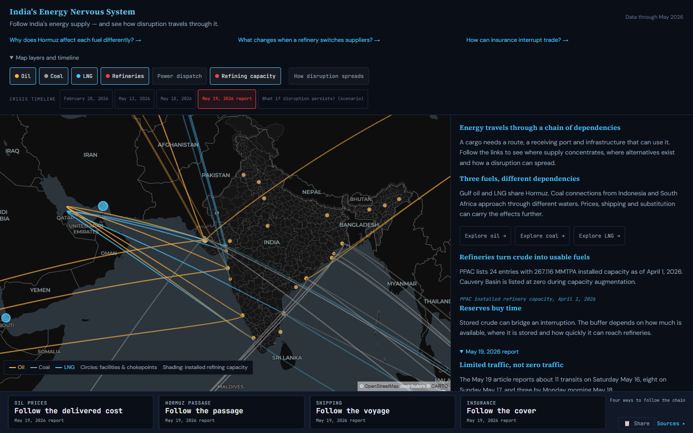

# India's Energy Nervous System

Follow India's energy supply -- and see how disruption travels through it.

**[View the dashboard](https://avyayalaya.github.io/india-energy/)**

*Data through May 2026.*

Oil, gas and coal reach India through different routes, facilities and commercial arrangements. Explore how those connections shape what happens when supply is interrupted.

## Start with a question

- **Why does Hormuz affect each fuel differently?** Follow the Gulf oil and LNG connections, then explore coal's different routes.
- **What changes when a refinery switches suppliers?** Look at the voyage, delivery time, crude properties and refinery fit.
- **How can insurance interrupt trade?** Follow the link from insurance cover to shipping decisions and delivered costs.

Each question on the page opens a short explanation and a route into the existing map or signal details.

---

---

## What you'll see

- **39 trade connections** across oil, coal and LNG
- **24 PPAC refinery entries**, totaling **267.116 MMTPA** as of April 1, 2026; Cauvery Basin is listed at zero during augmentation
- **335 historical MERIT dispatch entries across six allocation states**, using the original April 2 capture
- **18 state profiles** with refining capacity derived from the refinery list
- **Dated event reporting**, with a separate conditional scenario
- **Chokepoint analysis** -- Strait of Hormuz, Strait of Malacca, Suez Canal
- **Explanations of how disruption spreads** through insurance, shipping, prices and supply

## Explore

Start with a question, or open **Map layers and timeline** to explore freely. Leaving exactly one fuel active opens its summary. Select a refinery or other mapped facility for more detail; open **How disruption spreads** to follow the connections between events.

The four signal cards explain oil prices, passage, shipping and insurance. Their selected event follows the timeline. Exact market series that lacked supporting evidence have been removed. On smaller screens the map controls start collapsed, leaving room for the questions and map.

Open **Power dispatch** for the six allocation-state lists. The original source names, capacities, costs, scheduled energy and missing values are preserved. Allocation state describes the receiving system, not the physical location of a plant.

## Sources

The page brings together official datasets, reporting and explanations. Source links accompany the details, with a fuller list under **Sources and notes**. Read the [November 12 correction report](refreshes/india-energy-corrections-2026-11-12.md) for the changes and their evidence. Earlier notes and archive pages are superseded historical material.

Data definitions and editorial notes

| Layer | How to read it |
|-------|---------------|
| Dates | Reporting covers February-May 2026. Refinery capacity is dated April 1. MERIT tables were captured April 2; that capture date is not a claim that every row describes that day's dispatch. |
| Routes | Arcs show schematic origin/destination connections with equal width. No numerical route-flow or transit-time model is included. Connections do not identify individual cargo contracts. |
| State shading | Capacity bands: over 50, 10-50, and below 10 MMTPA; zero-listed and unassessed states are neutral. This measures refinery concentration rather than an overall risk score. |
| Facilities | Ports, LNG terminals and refineries are separate objects. Only supported terminal measures are displayed. Bongaigaon is included in lists and state totals; its map marker is withheld until its coordinates are verified. |
| Dispatch | The original capture's nulls remain missing and numeric zeros remain zero. Rows can describe a unit, allocation, fuel arrangement or aggregate. Unverified enrichment and plant coordinates have been removed. |
| Scenario | The prolonged-disruption view explains conditional choices; it supplies no numerical forecast. |

Unsupported price points, tanker rates, source percentages, reserve-cover comparisons and precise scenario effects have been removed from the current page rather than relabeled as facts. Share copies the page URL without preserving selections.

| Source | What it covers |
|--------|---------------|
| [PPAC](https://ppac.gov.in/infrastructure/installed-refinery-capacity) | Installed refinery capacity, April 1, 2026 |
| [Insurance Journal / Bloomberg](https://www.insurancejournal.com/news/international/2026/05/19/870495.htm) | Limited Hormuz traffic, May 19 reporting |
| [Al Jazeera](https://www.aljazeera.com/news/2026/5/18/iran-plans-to-offer-insurance-for-hormuz-transit-will-it-work) | Insurance proposal, PGSA announcement and maritime cover |
| [News24](https://news24online.com/world/indian-cargo-ship-haji-ali-sinks-after-suspected-drone-attack-in-strait-of-hormuz-india-calls-incident-unacceptable/836967/) | Haji Ali incident and crew rescue |
| [Petronet LNG](https://www.petronetlng.in/) | Separately identified LNG terminal capacities |
| [MERIT India](https://meritindia.in/) | Plant-level merit order dispatch data (Ministry of Power) |

## Technical details

Single self-contained HTML file. No build step, backend or API keys. Internet access is needed for externally hosted libraries, fonts, map tiles and state boundaries; energy records are embedded in the page.

| Library | Purpose |
|---------|---------|
| [deck.gl](https://deck.gl/) | WebGL-powered data visualization layers (arc, scatterplot, icon) |
| [MapLibre GL](https://maplibre.org/) | Open-source vector map rendering |
| [CARTO Dark Matter](https://carto.com/basemaps/) | Dark basemap tiles |
| JetBrains Mono + DM Sans | Typography |

## Local preview and regression checks

From the repository directory, run `python -m http.server 8766 --bind 127.0.0.1`, then open `http://127.0.0.1:8766/`.

Run `node tests/data-integrity.cjs` for dependency-free data regression checks.

Check 320px, 390px, 768px and desktop widths: the opening questions and map should fit without horizontal clipping. Open the map controls and exercise each layer and **How disruption spreads**. Use Tab plus Enter/Space for buttons and disclosures; verify Escape closes the active panel and modal focus returns to its opener. Spatial picking on the map uses pointer/touch interaction.

Follow each opening question into its explanation and map or signal detail. Keep a signal open while changing dates; the selected event should update. Verify allocation-state lists, zero versus missing values, facility units, and visible map attribution. Source notes stay on demand.

## License

Data sources retain their respective reuse terms. The repository has not yet selected a code license.

---

Built with [Agent Prime](https://github.com/avyayalaya).
